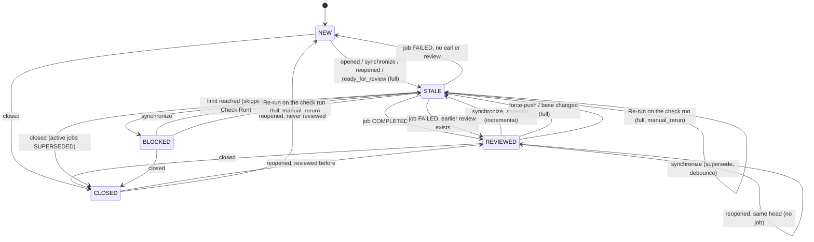

# Incremental review, duplicate suppression and limits

Issue #49 (sprint 4, tech lead). The design the team implements next: what the bot does
when new commits land on a pull request it has already reviewed, how it keeps old
findings from being posted twice, and which limits bound the cost of one pull request,
one installation and one day.

It is the contract for three tasks:

| Issue | Owner | Takes from this document |
| :--- | :--- | :--- |
| #54 | Pavel | §8.1: the implementation list (backend) |
| #50 | Victor | §8.2: the numbered acceptance scenarios (regression and chaos tests) |
| #52 | Igor | §8.3: the API fields and Check Run texts (console) |

Related documents: [WORKFLOW_DESIGN.md](./WORKFLOW_DESIGN.md) (ingest, gate, fingerprints,
cost), [PIPELINE_SPEC.md](./PIPELINE_SPEC.md) (job states, `error_kind`),
[configuration.md](./configuration.md) (knobs), [RULES_FORMAT_SPEC.md](./RULES_FORMAT_SPEC.md)
(rules source), [observability.md](./observability.md) (events and metrics).
Where this document and an older one disagree, this one describes the next state and
the older one is updated in the implementing PR.

Rule numbers **[I1]**, **[D1]**, **[L1]** are stable: tests and PRs cite them.

---

## 1. Current behaviour

What the code does today, before any change from this document.

### 1.1 Webhook ingest

| Behaviour | Where |
| :--- | :--- |
| Reviewable actions: `opened`, `synchronize`, `reopened`, `ready_for_review` | `adapters/github/payload.py:20-28` |
| Any other action (`edited`, `closed`, `labeled`, …) or event is answered 204 and ignored | `api/webhooks/github.py:158-173` |
| The payload's `head.sha`, `base.sha`, `head.ref`, `base.ref` and `draft` are parsed | `adapters/github/payload.py:104-119` |
| `draft` is parsed but no code skips a draft: drafts are reviewed | `adapters/github/payload.py:116`; no reader in `worker/` |
| Request body cap: 5 MiB, answered 413 | `api/webhooks/github.py:46`, `:130-133` |
| One job per delivery, with the payload SHAs and refs stored on the job | `api/webhooks/github.py:197-222` |

### 1.2 Dedup and supersede

`PostgresJobStore.enqueue` is one transaction (`adapters/db/repository.py:69-144`):

1. **Dedup by delivery id.** A delivery already recorded returns `None` and changes nothing
   (`:87-97`); the `ON CONFLICT (provider, delivery_id) DO NOTHING` insert is the race
   backstop (`:122`, `:141-142`). The webhook answers 202 `duplicate`
   (`api/webhooks/github.py:223-233`).
2. **Supersede.** Every `QUEUED`, `RETRYING` or `PROCESSING` job of the same
   `(installation_id, repo_id, pr_number)` becomes `SUPERSEDED` (`:98-111`).
3. **Insert and notify.** A new `QUEUED` job with `next_attempt_at = now()` (`:112-140`),
   then `pg_notify` (`:143`).

The in-memory twin does the same in the same order (`adapters/jobs/memory.py:73-110`,
supersede at `:97`).

A superseded `PROCESSING` job notices at its next lease renewal: `extend_lease` matches only
`status = 'PROCESSING'` (`adapters/db/repository.py:267-280`), and the worker renews before
the LLM call and before posting, stopping when the renewal fails
(`worker/process.py:281-282`, `:320-321`). No other "still newest" gate exists: the `GATE`
step is declared (`domain/jobs.py:94`) but no code records it.

Claim fairness: at most 3 `PROCESSING` jobs per installation
(`domain/jobs.py:26`, `adapters/db/repository.py:165-167`); lease 600 s (`domain/jobs.py:35`).

### 1.3 What every job reviews

| Step | Behaviour | Where |
| :--- | :--- | :--- |
| Fetch | The **whole** pull request diff, `GET /repos/{r}/pulls/{n}.diff`, plus the PR detail and up to 5 × 100 commits | `adapters/github/client.py:66-77`, `:25-28` |
| Diff cap | Over 5 MiB raises `ForgeUnavailableError`, which `_classify` maps to the **retryable** `forge_unavailable` | `adapters/github/client.py:29`, `:154-164`; `worker/process.py:165-166` |
| Reviewed SHA | The head SHA of the fetched PR, not the payload's: comments and the Check Run go to `context.head_sha` | `worker/process.py:284` |
| Filters | `binary`, `lockfile` (17 basenames), `minified` (`.min.js`, `.min.mjs`, `.min.css`, `.map`), `vendored` (`vendor`, `node_modules`, `third_party`, `third-party`) | `domain/diff_filter.py:16-20`, `:40-91` |
| LLM input | `context.diff_text`, the **unfiltered** diff: skipped files still reach the model and count against its budget | `worker/process.py:286-292` |
| Rules | The worker passes no `rules_markdown`; `.review/rules.md` is read only for the console preview. Wiring the file into the review is issue #37 (Igor) | `worker/process.py:287-291`; `domain/repository_rules.py:1-10`, `:24-26` |
| Commit messages | Fetched, never sent to the model: `ReviewRequest` has no such field | `domain/ports.py:32-36` |

### 1.4 Budgets that exist

| Budget | Value | Where | On exceed |
| :--- | :--- | :--- | :--- |
| LLM input per call (estimate: characters / 3) | 32 000 tokens, `LLM_MAX_INPUT_TOKENS` | `adapters/llm/config.py:21`; `adapters/llm/prompt.py:216-220`; check `adapters/llm/gateway.py:203-214` | `LLMInputTooLargeError`, no provider called |
| LLM reply per call | 16 384 tokens, `LLM_MAX_TOKENS` | `adapters/llm/config.py:18` | Reply cut, logged `llm.reply.truncated` (`adapters/llm/openai_compat.py:167-176`) |
| Per-file scope concurrency | 4 calls | `adapters/llm/gateway.py:52` | — |
| Comments per review | 25, `PublishPolicy.max_comments` | `domain/publishing.py:87-88` | The least severe are not posted |
| Token usage | Logged per call as `llm.response.usage`, **not returned** to the caller and not stored | `adapters/llm/openai_compat.py:162-186` | — |

Planned but not built: `daily_token_budget` (1 000 000, GLOBAL), `max_diff_bytes`
(1 MiB), `max_changed_files` (100), `max_reviews_per_pr` (20), `max_concurrent_per_repo` (2)
in `docs/configuration.md:125-155`; the quota gate of `docs/WORKFLOW_DESIGN.md:372-402`;
the `llm_tokens_total` and `llm_cost_usd_total` metrics of `docs/observability.md:391-394`
(no code references them).

### 1.5 Skipped Check Run (PR #63)

On `LLMInputTooLargeError` the worker posts a Check Run "⏭️ Review skipped: pull request
too large" with the estimate, the limit and the reviewable file count, updating the run an
earlier attempt left on the same SHA, then fails the job as `skip_diff_too_large`
(`worker/process.py:293-299`, `:400-432`; text in `domain/publishing.py:368-400`; lookup
by `app_id` in `adapters/github/publisher.py:125-147`). The job ends `FAILED`, not `SKIPPED`:
`_classify` returns it as non-retryable (`worker/process.py:177-178`) and `fail` writes
`FAILED` (`adapters/db/repository.py:241`), although PIPELINE_SPEC §5 lists it under
`SKIPPED` (`docs/PIPELINE_SPEC.md:256`).

### 1.6 Fingerprints

| Behaviour | Where |
| :--- | :--- |
| `fingerprint = sha256(path \0 normalised message \0 normalised anchored code)`; the line number is left out on purpose | `domain/publishing.py:173-184`; `docs/WORKFLOW_DESIGN.md:649-653` |
| Every inline comment carries `<!-- dmc268:fp=<sha256> -->` | `domain/publishing.py:38-39`, `:486` |
| Before posting, the worker loads every fingerprint posted on this PR by any job | `worker/process.py:300-309`; `adapters/db/review_comments.py:32-37`, `:61-74` |
| `build_plan` drops a finding whose fingerprint is already posted, or repeated in this reply | `domain/publishing.py:305-315` |
| Rows are written after the review is posted, one transaction, unique `(job_id, fingerprint)` | `worker/process.py:325-328`; `alembic/versions/0002_review_comments.py:59` |
| The publisher reads fingerprints back from GitHub comment bodies | `adapters/github/publisher.py:245` |
| Stale comments are never minimised or resolved | no code; option in `docs/WORKFLOW_DESIGN.md:664-665` |

The module docstring still says the worker passes an empty `posted_fingerprints`
(`domain/publishing.py:17`); the code at `worker/process.py:300-309` no longer does.

---

## 2. State machine of a pull request across pushes

### 2.1 What is stored per pull request

No new per-PR table: the state is derived from the PR's jobs, read through the existing
`ix_pr_review_jobs_pr_history` index (`alembic/versions/0001_review_jobs.py:156-159`).
Migration numbers are not fixed here. PR #64 (open) already adds
`alembic/versions/0003_pg_stat_statements.py`, so the two migrations of this document take
the next free revisions after the migrations of PR #64: `0004_incremental_review` and
`0005_llm_usage_daily` if #64 lands first. #54 rebases on whatever is merged by then and
numbers them after the last merged revision. Below they are named by suffix only.

Migration **`incremental_review`** adds to `pr_review_jobs`:

| Column | Type | Meaning |
| :--- | :--- | :--- |
| `reviewed_head_sha` | `CHAR(40) NULL` | The SHA the review actually ran on (`context.head_sha`), set on `COMPLETED`. Differs from `head_sha` when a push landed between enqueue and fetch |
| `reviewed_base_sha` | `CHAR(40) NULL` | The PR base SHA at that moment |
| `review_mode` | `VARCHAR(16) NULL` | `full` or `incremental` |
| `delta_from_sha` | `CHAR(40) NULL` | For `incremental`: the `last_reviewed_sha` the delta started from |
| `full_reason` | `VARCHAR(32) NULL` | For `full`: why (§3, step 3) |
| `rules_digest` | `CHAR(64) NULL` | sha256 of the `.review/rules.md` bytes the review used; NULL without a file |
| `input_tokens`, `output_tokens` | `INTEGER NOT NULL DEFAULT 0` | Provider-reported usage of every call of the job, retries and the summary agent included (§6.3) |

Derived values:

| Name | Definition |
| :--- | :--- |
| `last_reviewed` | The newest job of the PR with `status = 'COMPLETED'` and `reviewed_head_sha IS NOT NULL` |
| `last_reviewed_sha` | `last_reviewed.reviewed_head_sha` |
| `pr_tokens_used` | `SUM(input_tokens + output_tokens)` over all jobs of the PR (§6, [L4]) |

Migration **`llm_usage_daily`** adds the installation budget table (§6.3).

### 2.2 States

| State | Meaning |
| :--- | :--- |
| `NEW` | No completed review yet |
| `REVIEWED` | `last_reviewed_sha` equals the current head |
| `STALE` | The head moved past `last_reviewed_sha`; a job is queued or running |
| `BLOCKED` | The last job was skipped by a limit (§6); no review for this head |
| `CLOSED` | The PR is closed or merged; nothing runs |

The state is not a column: it is read from the jobs. The table below is the contract.

### 2.3 Transitions

| From | Event | Condition | To | Job enqueued |
| :--- | :--- | :--- | :--- | :--- |
| `NEW` | `opened`, `ready_for_review` | — | `STALE` | full (`first_review`) |
| `NEW` | `synchronize`, `reopened` | — | `STALE` | full (`first_review`) |
| `REVIEWED`, `BLOCKED` | `synchronize` | `last_reviewed_sha` is an ancestor of the new head | `STALE` | incremental |
| `REVIEWED`, `BLOCKED` | `synchronize` (force-push) | `last_reviewed_sha` is not an ancestor | `STALE` | full (`force_push`) |
| `REVIEWED` | `edited` with `changes.base` | base branch changed | `STALE` | full (`base_changed`) |
| `REVIEWED` | `reopened`, `ready_for_review` | head equals `last_reviewed_sha` | `REVIEWED` | none: `skip_already_reviewed` |
| `REVIEWED` | `reopened`, `ready_for_review` | head moved | `STALE` | as `synchronize` |
| `NEW`, `REVIEWED`, `BLOCKED` | Re-run on the AI review Check Run ([I4]) | — | `STALE` | full (`manual_rerun`), even when the head equals `last_reviewed_sha` |
| `STALE` | Re-run ([I4]) | — | `STALE` | the queued one is superseded; the new one is full (`manual_rerun`) |
| `STALE` | `synchronize` | — | `STALE` | the queued one is superseded (§1.2); new one as above |
| `STALE` | job `COMPLETED` | — | `REVIEWED` | — |
| `STALE` | job skipped by a limit | — | `BLOCKED` | — |
| `STALE` | job `FAILED` | retries exhausted | `REVIEWED` if a review exists, else `NEW` | — |
| any | `closed` | — | `CLOSED` | none; active jobs → `SUPERSEDED` |
| `CLOSED` | `reopened` | — | `REVIEWED` or `NEW` by history | then as the rows above |

Close and reopen no longer re-runs a reviewed head: today every `reopened` enqueues a full
review (`adapters/github/payload.py:20-28`), after this change a reopen on the same head is
`skip_already_reviewed`. The way to force a review of an unchanged head is the Re-run
button ([I4]). From `BLOCKED` a re-run still passes the gate (§6.4) and is blocked again while
the limit holds.

The mode (full or incremental) is **decided by the worker at run time**, not at ingest
(§3, step 3): the payload cannot tell a force-push from a fast-forward, and a queued job may
run against a newer head than its payload names.



### 2.4 Ingest changes

1. **[I1]** `edited` is reviewable only when the payload carries `changes.base`; any other
   `edited` stays ignored. It enqueues a job with `event_action = 'edited'`.
2. **[I2]** `closed` is routed to a cancel path: supersede the PR's active jobs (the same
   UPDATE as `adapters/db/repository.py:98-111`), insert nothing, answer 202
   `{"status": "cancelled"}`.
3. **[I3]** Debounce: a `synchronize` job is inserted with
   `next_attempt_at = now() + REVIEW_DEBOUNCE_SECONDS`. The claim already waits for
   `next_attempt_at <= now()` (`adapters/db/repository.py:164`), so pushes inside the window
   supersede the waiting job and one review runs. `opened`, `reopened`,
   `ready_for_review`, `edited` and a manual re-run are not delayed.
4. **[I4]** Manual re-run: the "Re-run" button on the AI review Check Run. GitHub sends a
   `check_run` event with action `rerequested` to the App that created the run; the App
   must be subscribed to Check run events (App settings, not code). Today every event other
   than `pull_request` is answered 204 (`api/webhooks/github.py:158-164`). The new route:
   - accept only `check_run.name == "AI review"` (`adapters/github/publisher.py:45`) and
     `check_run.app.id` equal to our App id; anything else, and other `check_run` or
     `check_suite` actions, stay 204;
   - take the PR from `check_run.pull_requests[0]` (number, head and base SHA and ref). The
     list is empty for a PR from a fork: answer 204 and log `webhook.ignored`, the re-run
     is not available there;
   - enqueue a job with `event_action = 'rerun'` through the usual insert: delivery dedup
     and supersede apply (§1.2), no debounce. The worker reviews the current head and sets
     `full_reason = manual_rerun` (§3, step 3);
   - only users with write access to the repository can press the button, so it is not an
     outside abuse path; every re-run counts against L10 and the token limits like any
     other review.

---

## 3. Incremental algorithm

Runs in the worker after the fetch, before the LLM call. Steps are numbered for tests.

1. **Fetch the PR** as today (`adapters/github/client.py:50-95`): detail, commits, full diff
   `base...head`. Call this the **PR diff**; `H` is `context.head_sha`.
2. **Find `last_reviewed`** (§2.1). None → full, reason `first_review`.
3. **Choose the mode.** Full review, with the first reason that applies:

   | Condition | `full_reason` |
   | :--- | :--- |
   | `event_action = 'rerun'` (manual re-run, [I4]) | `manual_rerun` |
   | No `last_reviewed` | `first_review` |
   | `last_reviewed_sha == H` | none: terminate `SKIPPED`, `skip_already_reviewed`, post nothing |
   | Compare `last_reviewed_sha...H` returns `status` other than `ahead` (`diverged`, `behind`) or 404 (the SHA is gone) | `force_push` |
   | The job's `base_ref` differs from `last_reviewed`'s `base_ref`, or `event_action = 'edited'` | `base_changed` |
   | The delta touches `.review/rules.md`, or the rules digest at `H` differs from `last_reviewed.rules_digest` | `rules_changed` |
   | The delta has no reviewable file after step 5 and the rules did not change | none: terminate `SKIPPED`, `skip_no_reviewable_files`, Check Run per §8.3 |
   | The delta is larger than `REVIEW_INCREMENTAL_MAX_RATIO` (0.8) of the PR diff, by reviewable lines | `delta_too_large` (one review of everything costs about the same) |
   | `REVIEW_INCREMENTAL=false` | `incremental_disabled` |

   Otherwise: incremental.
4. **Fetch the delta** (incremental only):

   ```
   GET /repos/{owner}/{repo}/compare/{last_reviewed_sha}...{H}
   Accept: application/vnd.github+json        (status, ahead_by, files[])
   GET /repos/{owner}/{repo}/compare/{last_reviewed_sha}...{H}
   Accept: application/vnd.github.diff        (the delta diff, same 5 MiB cap)
   ```

   The JSON `status` drives step 3 (`ahead` = fast-forward). The diff text is parsed with
   `domain.diff.parse_diff` (`domain/diff.py:194`).
5. **Restrict the delta to the PR.** A delta can contain changes that are not the PR's: a
   merge of the base branch into the PR branch brings in other people's commits. Keep from
   the delta only:
   - files present in the PR diff and kept by the filters (§6.2);
   - within them, hunks with at least one added line that is also an added line of the PR
     diff at the same new-file line number.

   New-side line numbers of the delta and of the PR diff both count lines of the file at
   `H`, so they are comparable without mapping. Old-side numbers are not (the delta's old
   side is `last_reviewed_sha`, the PR diff's is the base), so removed lines of the delta are
   context for the model only.
6. **Build the LLM input** from the restricted delta, split per file with
   `domain.diff.split_by_file` (`domain/diff.py:375`) and joined back, and the same title,
   description and rules as a full review. The Check Run says the review is incremental
   (§8.3).
7. **Publish against the PR diff.** `CommentableLines` is built from the **PR diff** kept
   files, as today (`worker/process.py:313`), never from the delta. So:
   - a finding on a new-side line of the PR diff posts as usual (`commit_id = H`,
     `adapters/github/publisher.py:196`);
   - a finding on a delta line that is not in the PR diff (a line the merge brought in) is
     dropped as `outside_diff` (`domain/publishing.py:11-12`);
   - a finding with `side = old` from an incremental review is dropped and counted as
     `delta_old_side`: its line number refers to `last_reviewed_sha`, not the base.
8. **Dedup** (§4) against every fingerprint posted on the PR.
9. **Record** `reviewed_head_sha = H`, `reviewed_base_sha`, `review_mode`, `delta_from_sha`,
   `full_reason`, `rules_digest`, `input_tokens`, `output_tokens` on `COMPLETED`.

**The Check Run of an incremental review** covers the delta: summary, risk and checklist
of the new commits. The risk floor uses the findings published by this job plus the
still-open findings of earlier jobs (§5.2), so a High from an earlier push does not
disappear when the next push touches only a README.

---

## 4. Duplicate suppression

### 4.1 What counts as "the same finding"

**[D1]** Two findings are the same when their fingerprints are equal. The fingerprint
stays as it is (`domain/publishing.py:173-184`): path, normalised message, normalised
anchored code. Changing it re-posts every finding ever made, and a golden test guards it
(`domain/publishing.py:178-179`).

| Change between reviews | Same fingerprint? | Result |
| :--- | :--- | :--- |
| Lines inserted above the finding, the anchored line unchanged | yes | not reposted |
| Whitespace or indentation of the anchored line changed | yes (whitespace collapsed) | not reposted |
| The anchored line itself edited | no | posted again if the model still reports it |
| The file renamed | no (path is an input) | posted again |
| Same defect, model words the message differently | **no** | posted again |
| Same defect, same message, now on two identical lines | yes | one comment |

### 4.2 Second key: the defect key

The last-but-one row is the real source of duplicates on re-review: the message is model
text and varies between runs. **[D2]** A second key, computed alongside and stored on
`pr_review_comments` (new column `defect_key CHAR(64) NULL`, migration `incremental_review`):

```
defect_key = sha256(path \0 category \0 side \0 normalised anchored code \0 rule_id or "")
```

A finding is suppressed when its fingerprint **or** its defect key was already posted on
the PR. Trade-off: two different defects of the same category on the same line text
collapse into one comment. That is accepted: one comment on a line is enough to make a
human look, and repeated comments are the complaint this issue exists for.

### 4.3 Order and rules

1. **[D3]** Load fingerprints and defect keys of every posted comment of the PR, any job
   (extends `adapters/db/review_comments.py:32-37`).
2. **[D4]** Only posted comments count. Findings dropped by `min_severity`, `max_comments`
   or the verifier are not recorded, so lowering a threshold later can post them
   (`docs/configuration.md:257-262`).
3. **[D5]** Dedup runs after the position filter and the severity filter, before the
   comment cap, as today (`domain/publishing.py:298-317`).
4. **[D6]** Full and incremental reviews dedup the same way; a full review after a
   force-push posts only what is new.
5. **[D7]** The Check Run counts suppressed duplicates: "N findings were already posted on
   earlier commits" (existing stat `already_posted`, `domain/publishing.py:340`).

---

## 5. Outdated and resolved findings

### 5.1 What GitHub does

- A review comment is anchored to `commit_id` + line. When a later push changes that line or
  its hunk so the position no longer exists in the new diff, GitHub marks the comment
  **Outdated** in the conversation and hides it from "Files changed". Nothing for us to do.
- A comment on a line that did not change stays current on the new head.
- Resolving a conversation is a human action in the UI, or the GraphQL
  `resolveReviewThread` mutation; minimising is `minimizeComment`.

### 5.2 Policy this sprint

1. **[O1]** Never repost a finding already posted on the PR (§4).
2. **[O2]** Rely on GitHub's Outdated marking. No auto-resolve, no minimise.
3. **[O3]** A finding counts as **open** for the risk floor and the Check Run "earlier
   findings" line while its comment is not Outdated. Outdated is not tracked in our
   database this sprint; the Check Run counts earlier posted comments only, worded
   "posted on earlier commits", never "open".
4. **[O4]** The console shows earlier findings per job as today; it does not claim they
   are fixed.

### 5.3 Later option: auto-resolve

When a full or incremental review no longer reports a finding whose anchored line changed,
resolve its thread with `resolveReviewThread`.

| Risk | Why |
| :--- | :--- |
| False "fixed" | The model is not deterministic; a finding missing from one run does not mean the code is fixed (run-to-run noise ±5 points of recall on the eval) |
| Hides a human's discussion | Resolving collapses the thread, replies included |
| Permissions | Needs `pull_requests: write` on GraphQL for review threads; check the App manifest |
| Partial reviews | An incremental review sees only the delta; it cannot judge a finding in a file it did not review |

Safe subset if adopted: resolve only threads whose anchored line no longer exists at the
new head (deleted code), never on the model's silence alone; behind a per-repository
setting, off by default.

---

## 6. Limits

### 6.1 Table

Env vars now; each maps to the `docs/configuration.md` knob in the last column when the
config resolver lands. Scope of a future override: a repository may only lower a limit
(`docs/BACKEND_ARCHITECTURE.md:604-607`).

| # | Limit | Default | Env var | Enforced | User-visible result | `error_kind` | configuration.md |
| :--- | :--- | :--- | :--- | :--- | :--- | :--- | :--- |
| L1 | Webhook body | 5 MiB | — | `api/webhooks/github.py:130-133` | 413, no job | — | — |
| L2 | Fetched diff (PR or delta) | 5 MiB | `REVIEW_MAX_FETCH_BYTES` | GitHub client, streaming | Skipped Check Run "pull request too large" | `skip_diff_too_large` (permanent; today retryable, §1.3) | — |
| L3 | Reviewable diff after filters | 1 MiB | `REVIEW_MAX_DIFF_BYTES` | worker, after filters | Skipped Check Run "too large" | `skip_diff_too_large` | `max_diff_bytes` |
| L4 | Reviewable files | 100 | `REVIEW_MAX_CHANGED_FILES` | worker, after filters | Skipped Check Run "too many files" | `skip_diff_too_large` | `max_changed_files` |
| L5 | One file's diff | 1 MiB | `REVIEW_MAX_FILE_BYTES` | `diff_filter` | File skipped, listed in the Check Run | (file reason `too_large`) | — |
| L6 | Generated files | on | — | `diff_filter` | File skipped | (file reason `generated`) | `ignore_globs` |
| L7 | LLM input per call | 32 000 | `LLM_MAX_INPUT_TOKENS` (exists) | gateway (`adapters/llm/gateway.py:203-214`) | Skipped Check Run (PR #63) | `skip_diff_too_large` | — |
| L8 | LLM reply per call | 16 384 | `LLM_MAX_TOKENS` (exists) | provider | Reply cut, corrective retry | — | — |
| L9 | Tokens per PR, all reviews | 300 000 | `REVIEW_PR_TOKEN_CAP` | worker gate | Skipped Check Run "per-PR budget reached" | `skip_pr_budget` | — |
| L10 | Reviews per PR | 20 | `REVIEW_MAX_REVIEWS_PER_PR` | worker gate | Skipped Check Run | `skip_pr_budget` | `max_reviews_per_pr` |
| L11 | Daily tokens per installation | 1 000 000 | `REVIEW_DAILY_TOKEN_BUDGET` | worker gate | Skipped Check Run "daily budget used" | `quota_exhausted` | `daily_token_budget` |
| L12 | Soft buffer on L11 | 10 % | `REVIEW_QUOTA_SOFT_BUFFER_PCT` | worker gate | — | — | `quota_soft_buffer_pct` |
| L13 | In-flight jobs per installation | 3 | — (exists) | claim (`adapters/db/repository.py:165-167`) | Jobs wait in the queue | — | — |
| L14 | Debounce of `synchronize` | 20 s | `REVIEW_DEBOUNCE_SECONDS` | enqueue (§2.4, [I3]) | Fewer reviews on push bursts | — | — |
| L15 | Comments per review | 25 | — (exists) | `domain/publishing.py:88` | The rest counted in the Check Run | — | `max_comments_per_review` |

Defaults reasoning: L9 is about six reviews of a PR at both the 32 000 input and the
16 384 reply cap, or about thirty reviews of the size the 29-file eval bundle used
(~8 000 input and ~2 500 output tokens, `docs/specs/llm-gateway.md` § #55); L11 is the configuration.md default; L3 and L4 are the configuration.md defaults;
L14 covers a typical `git push` burst of a rebase plus a fix-up without delaying a single
push noticeably.

### 6.2 File filters

Existing reasons stay (`domain/diff_filter.py:16-20`). New ones, appended to `SkipReason`
(the enum order is the check order):

| Reason | Rule |
| :--- | :--- |
| `generated` | Basename or path matches `*_pb2.py`, `*_pb2_grpc.py`, `*.pb.go`, `*.generated.*`, `*.g.dart`, `*.designer.cs`, segment `__generated__`; or the first 5 added lines of a new file contain `@generated` or `Code generated` … `DO NOT EDIT` |
| `too_large` | The file's diff text is over `REVIEW_MAX_FILE_BYTES` |
| `rules_ignore` | `path:` directives of `.review/rules.md` (`docs/RULES_FORMAT_SPEC.md:127-148`), when rules reach the worker |

**[L-F1]** The LLM input is built from the kept files only (today the whole diff is sent,
`worker/process.py:286-292`). This is the first fix of #54: a 900-line lockfile today costs
tokens and can push a small PR over L7.

**[L-F2]** All files skipped → terminate `SKIPPED` with `skip_no_reviewable_files` and a
Check Run listing the skipped counts (no paths of more than 30 files).

### 6.3 Token accounting

1. **[L-T1]** The gateway returns usage: `ReviewResult.usage = TokenUsage(input_tokens,
   output_tokens, calls)`, summed over every provider call of the review (first pass,
   corrective retry, per-file calls, summary agent). Source: the `usage` the provider
   already logs (`adapters/llm/openai_compat.py:164-186`). A reply without `usage` counts
   the gateway's estimate for input (`adapters/llm/prompt.py:216-220`) and 0 for output,
   and logs `llm.usage.missing`.
2. **[L-T2]** TypeSafe (rule screen, verifier) tokens are reported separately
   (`typesafe_input_tokens`, `typesafe_output_tokens`) and do not count against L9 or L11:
   another provider and another bill.
3. **[L-T3]** A job writes its usage on `pr_review_jobs` (§2.1) and adds it to the
   installation's day in one transaction with the status change:

   ```sql
   -- migration llm_usage_daily
   CREATE TABLE llm_usage_daily (
     installation_id BIGINT NOT NULL,
     usage_date      DATE   NOT NULL,          -- UTC
     input_tokens    BIGINT NOT NULL DEFAULT 0,
     output_tokens   BIGINT NOT NULL DEFAULT 0,
     reviews         INTEGER NOT NULL DEFAULT 0,
     skipped         INTEGER NOT NULL DEFAULT 0,
     updated_at      TIMESTAMPTZ NOT NULL DEFAULT now(),
     PRIMARY KEY (installation_id, usage_date)
   );
   -- on job completion or failure after an LLM call
   INSERT INTO llm_usage_daily AS u (installation_id, usage_date, input_tokens, output_tokens, reviews)
   VALUES (:inst, (now() AT TIME ZONE 'UTC')::date, :in, :out, 1)
   ON CONFLICT (installation_id, usage_date) DO UPDATE
     SET input_tokens = u.input_tokens + EXCLUDED.input_tokens,
         output_tokens = u.output_tokens + EXCLUDED.output_tokens,
         reviews = u.reviews + 1, updated_at = now();
   ```

   A failed job that called the LLM is charged too: the tokens were spent.
4. **[L-T4]** Reset: the day is the UTC date of the charge; the budget resets at 00:00 UTC.
   `reset_at` = next 00:00 UTC.
5. **[L-T5]** Installation = organisation or personal account the App is installed on
   (`installation_id`). Per-author budgets (`max_reviews_per_author_per_day`,
   `docs/configuration.md:125`) come later.

### 6.4 The gate

A new `GATE` step (the step exists in `domain/jobs.py:94`), after the filters and the
mode choice, before the LLM call:

1. Still the newest job of the PR: `extend_lease` succeeds (today's check, made explicit).
2. `estimate = estimated input tokens of the review input + REVIEW_OUTPUT_RESERVE` (4 096).
3. L10: reviews of this PR (completed and skipped by L9-L11 excluded) < limit.
4. L9: `pr_tokens_used + estimate <= REVIEW_PR_TOKEN_CAP`.
5. L11: `today.input + today.output + estimate <= budget × (1 + buffer)`.
6. Any failure → skipped Check Run (§8.3), job `SKIPPED` with the `error_kind` of §6.1,
   `skipped` counter +1 in `llm_usage_daily`, event `job.gate.blocked`.

**Race:** up to 3 jobs of one installation pass the gate at once (L13), so the day can
overshoot by at most 3 × (L7 + L8) ≈ 145 000 tokens. Accepted and bounded; the soft buffer
absorbs it. A reservation scheme is listed in §9.

---

## 7. Abuse and security

| Threat | Today | After this spec |
| :--- | :--- | :--- |
| Giant PR | Over 5 MiB: retried as `forge_unavailable` (§1.3); over 32 000 input tokens: skipped Check Run | L2 permanent skip; L3, L4 before any LLM call |
| Lock files | Skipped from stats but still sent to the LLM (`worker/process.py:286-292`) | [L-F1]: never sent |
| Generated code | Reviewed and billed | `generated` filter (§6.2) |
| Push flood (many pushes a minute) | Supersede (§1.2): one job survives, but each claimed job may already have spent tokens | Debounce [I3]; supersede also cancels before the gate |
| Many PRs from one author | Nothing | L11 per installation now; per-author later |
| Re-review loop on one PR | Nothing | L9, L10 |
| PR edits `.review/rules.md` to mute its own review | Rules are not applied by the worker yet (§1.3); when they are, the head version applies (`docs/RULES_FORMAT_SPEC.md:55-75`) | Unchanged decision; the rules change forces a full review (§3) and the Check Run says the PR changed its own rules (`docs/RULES_FORMAT_SPEC.md:71-75`). Option in §9 |
| Prompt injection in rules | Pattern filter and JEV screen (`adapters/llm/rules.py`, `adapters/llm/rule_screen.py`; `docs/specs/llm-gateway.md`) | Unchanged |
| Prompt injection in title, description, diff | Untrusted markers and escaping (`adapters/llm/prompt.py`; AGENTS.md rule 6) | Unchanged; the delta goes through the same `diff_block` |
| Prompt injection in commit messages | Not sent to the model (`domain/ports.py:32-36`) | Unchanged. If commit messages are ever added, they go inside an `UNTRUSTED_*` block through `escape_markers` |
| Draft PRs spending budget | Reviewed (`adapters/github/payload.py:116` unused) | Out of scope; `skip_draft` stays in `docs/PIPELINE_SPEC.md:252` for the config work |
| Bot reviewing itself | The App does not push commits | Unchanged |

---

## 8. Contracts

### 8.1 #54: backend implementation

1. Migration `incremental_review`: the `pr_review_jobs` columns of §2.1 and
   `pr_review_comments.defect_key`. Revision number: the next free one after the
   migrations of PR #64 (§2.1); rebase on whatever is merged.
2. Migration `llm_usage_daily` (§6.3), the revision after it.
3. Ingest: [I1] `edited` with `changes.base`, [I2] `closed` cancel path, [I3] debounce; the
   memory twin (`adapters/jobs/memory.py`) in the same order.
4. GitHub client: `compare(base_sha, head_sha)` returning `status` and the diff text
   under L2; a diff over L2 raises a permanent error mapped to `skip_diff_too_large`, not
   `ForgeUnavailableError`.
5. Worker: `last_reviewed` lookup, mode choice (§3 step 3), delta restriction (step 5),
   old-side drop with the `delta_old_side` count, recording of step 9.
6. Filters: `generated`, `too_large` reasons; LLM input from kept files only ([L-F1]);
   `skip_no_reviewable_files` ([L-F2]).
7. Gateway: `ReviewResult.usage` ([L-T1], [L-T2]).
8. Gate step with L9, L10, L11 and the skipped Check Runs of §8.3; `llm_usage_daily`
   charging ([L-T3]); the `SKIPPED` status for every `skip_*` and `quota_exhausted` kind
   (today `skip_diff_too_large` ends `FAILED`, §1.5).
9. Dedup by fingerprint or defect key ([D2], [D3]).
10. Check Run texts of §8.3, including the incremental header and "earlier commits" line.
11. Env vars of §6.1 in a settings class with the validation style of
    `adapters/llm/config.py`; documented in `docs/configuration.md`.
12. Events (AGENTS.md rule 9, `docs/observability.md` Events table): `job.mode.chosen`
    (`mode`, `full_reason`, `delta_files`, `pr_files`), `job.gate.blocked` (`limit`,
    `used`, `estimate`, `limit_value`), `llm.usage.missing`; fields counts only.
13. API of §8.3 and `docs/openapi.yaml` in the same PR (`docs/PIPELINE_SPEC.md:465-477`).
14. Fix the stale docstring `domain/publishing.py:17`.
15. Manual re-run [I4]: the `check_run` `rerequested` route in `api/webhooks/github.py`,
    `event_action = 'rerun'`, `full_reason = manual_rerun` in the mode choice; the App
    subscription to Check run events goes into the deploy notes.

### 8.2 #50: acceptance scenarios

Each is a test (unit with the memory stores and `httpx.MockTransport`, or e2e on
PostgreSQL as `tests/test_e2e_*.py`).

1. `opened` on a new PR → one full review, `full_reason = first_review`.
2. `synchronize` with the previous head as ancestor → incremental; the LLM input holds
   only the delta files; the Check Run says "Incremental review".
3. Force-push (compare `status = diverged`) → full, `force_push`.
4. Compare returns 404 for the old SHA → full, `force_push`.
5. `edited` with `changes.base` → full, `base_changed`; `edited` without it → 204, no job.
6. The delta touches `.review/rules.md` → full, `rules_changed`.
7. Push whose only changes are skipped files → `SKIPPED`, `skip_no_reviewable_files`,
   Check Run posted, no LLM call.
8. Merge of the base branch into the PR branch → findings on lines that are not in the PR
   diff are not posted.
9. Incremental finding with `side = old` → not posted, counted `delta_old_side`.
10. Same defect reworded by the model on the next push → not reposted (defect key).
11. Lines inserted above an earlier finding → not reposted (fingerprint).
12. Anchored line edited, model reports again → posted once more (new fingerprint and
    key), the old comment shows Outdated on GitHub.
13. `reopened` with the head already reviewed → no job, no LLM call
    (`skip_already_reviewed`).
14. `closed` while a job is `QUEUED` or `PROCESSING` → job `SUPERSEDED`, nothing posted.
15. Five `synchronize` deliveries within the debounce window → one LLM call.
16. Redelivered `synchronize` (same delivery id) → 202 `duplicate`, the queued job is not
    superseded (existing, `adapters/db/repository.py:73-97`).
17. Installation budget reached → `SKIPPED`, `quota_exhausted`, Check Run with `reset_at`;
    after 00:00 UTC the next push reviews.
18. Per-PR cap reached → `SKIPPED`, `skip_pr_budget`; other PRs of the installation still
    review.
19. Usage is charged on `COMPLETED` and on `FAILED` after an LLM call, never on a job
    superseded before the gate.
20. Provider reply without `usage` → charged by estimate, `llm.usage.missing` logged.
21. Diff over 5 MiB → `SKIPPED`, `skip_diff_too_large`, no retry.
22. Generated file (`*_pb2.py`, `// Code generated ... DO NOT EDIT.`) → skipped, listed.
23. Lockfile in the PR → not in the LLM input (assert on the request body length or the
    recorded messages).
24. Chaos: worker killed after the LLM call, before posting → retry does not double-charge
    the day (usage written with the status change, [L-T3]) and does not double-post
    (`docs/PIPELINE_SPEC.md:396-420`).
25. Chaos: two jobs of one installation pass the gate together at the edge of the budget →
    overshoot is at most the bound of §6.4.
26. Re-run on the AI review Check Run of an already reviewed head → one full review,
    `full_reason = manual_rerun`, LLM called; the same event for another App's check run,
    another check name or an empty `pull_requests` (fork) → 204, no job.

### 8.3 #52: console API and Check Run texts

`GET /usage` (installation of the session, the same scoping as `/jobs`):

| Field | Type | Meaning |
| :--- | :--- | :--- |
| `installation_id` | int | |
| `period` | `"day"` | |
| `used_tokens` | int | input + output of today (UTC), from `llm_usage_daily` |
| `limit_tokens` | int | L11 |
| `soft_buffer_pct` | int | L12 |
| `remaining_tokens` | int | `max(0, limit − used)` |
| `reviews_today`, `skipped_today` | int | |
| `reset_at` | RFC 3339 UTC | next 00:00 UTC |
| `pr_token_cap`, `max_reviews_per_pr` | int | L9, L10 |
| `history` | `[{date, used_tokens, reviews, skipped}]` | last 14 days |

New fields on a job (`GET /jobs/{id}` and list items): `review_mode`, `full_reason`,
`delta_from_sha`, `reviewed_head_sha`, `input_tokens`, `output_tokens`, and
`pr_tokens_used` on the detail.

Check Run texts (counts only, no paths beyond the existing file list):

| Case | Title | Body |
| :--- | :--- | :--- |
| Incremental | (verdict as today) | First line: `Incremental review of {n} commit(s) since {short_sha}.` |
| Full after force-push / base / rules change / manual re-run | (verdict as today) | First line: `Full review: {reason text}.` |
| Earlier findings | — | `{n} finding(s) were already posted on earlier commits.` |
| `skip_diff_too_large` (L2-L4, L7) | `⏭️ Review skipped: pull request too large` | existing text (`domain/publishing.py:368-387`), plus which limit |
| `skip_no_reviewable_files` | `⏭️ Review skipped: no reviewable files` | `All {n} changed files are lockfiles, generated, vendored, minified or binary.` |
| `skip_pr_budget` | `⏸️ Review paused: this pull request's budget is used` | `This pull request used {used:,} of {cap:,} tokens across {reviews} reviews.` |
| `quota_exhausted` | `⏸️ Review paused: daily budget used` | `The installation used {used:,} of {limit:,} tokens today. Reviews resume at {reset_at} UTC.` |

Conclusion of every skipped run: `skipped`, as PR #63 (`domain/publishing.py:393`).

---

## 9. Open questions / decisions

| # | Question | Decision taken here | Revisit when |
| :--- | :--- | :--- | :--- |
| Q1 | Per-PR state table or derived from jobs? | Derived from `pr_review_jobs` plus new columns (§2.1): one source of truth, no sync bug | Lookups get slow; then a `pr_review_state` table |
| Q2 | Debounce default | 20 s, `synchronize` only | Users complain the bot is slow |
| Q3 | Gate race | Bounded overshoot (§6.4) instead of reservations | Budgets become money (billing): then reserve with `UPDATE … RETURNING` and settle at completion |
| Q4 | Incremental Check Run: delta or whole PR? | Delta summary; earlier findings as a count | Feedback from the console |
| Q5 | Same-line, same-category defects collapse ([D2]) | Accepted | Precision of the defect key measured on real PRs |
| Q6 | Rules source | PR head, decision of 20 October (`docs/RULES_FORMAT_SPEC.md:55-75`) | — |
| Q7 | Rules from the default branch (Victor, PR #47) | Later, as a per-repository setting `rules_source = head \| default_branch`, default `head`. Gains: a PR cannot weaken its own review. Costs: a PR that adds a rule does not see it until merged; a fork PR runs on rules it cannot see; needs the default branch name from the repository API | A team asks for it, or abuse is seen |
| Q8 | TypeSafe tokens in the budget | Not counted ([L-T2]) | TypeSafe becomes a paid cost line |
| Q9 | Full review when the delta is most of the PR | Ratio 0.8 (`REVIEW_INCREMENTAL_MAX_RATIO`) | Eval of incremental vs full recall |
| Q10 | Incremental recall | The model sees less context than a full review; findings that need unchanged code may be missed. Mitigated by CONTEXT_AND_VERIFICATION_SPEC context when it lands | Eval run with a two-commit dataset case |
| Q11 | Auto-resolve | Not this sprint (§5.3) | Outdated tracking exists |
| Q12 | `skip_diff_too_large` ends `FAILED` today | Becomes `SKIPPED` in #54 (§8.1 item 8), matching `docs/PIPELINE_SPEC.md:256` | — |
| Q13 | Rules are not passed to the review today | #54 does not wire them; that is issue #37 (Igor). The `rules_changed` reason works from the delta and the digest, so it is ready when #37 lands | #37 lands |
| Q14 | Drafts are reviewed | Unchanged here | Config work (`review_drafts`) |
