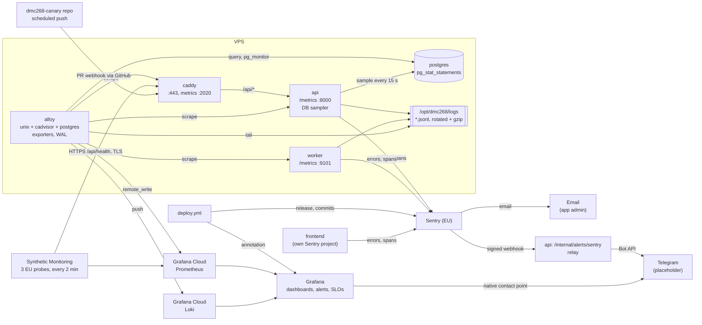

# Observability

Logs, metrics, traces and alerts for the API, the worker, the queue and the host.
This document extends [BACKEND_ARCHITECTURE.md § Observability](./BACKEND_ARCHITECTURE.md)
(which lists *what* to measure) with *how* and *in what order*. Hard rules 2 and 3 of
[AGENTS.md](../AGENTS.md) apply to every signal below: no secrets, no raw diffs, prompts or
model responses, in any log line, span, metric label or alert.

## Definition of done

1. A Grafana dashboard shows, for production: API RPS, error rate and p50/p95 latency per
   route; host CPU, RAM and disk; container CPU and RAM; Postgres connections; queue depth.
2. Sentry shows grouped errors with release (git sha) and environment, and a trace per API
   request, `/health` and `/metrics` excluded.
3. An LLM gateway call appears as a span with provider, model, tokens and outcome.
4. An error triggers a Sentry email and reaches the Telegram relay; an infrastructure alert
   fires in Grafana. Until the bot is connected both Telegram paths are placeholders: the
   relay logs `alert.dropped`, and the Grafana alert shows as *firing*.
5. With the vendors unreachable, logs are still written to rotated files on the VPS.
6. **When the worker lands:** one trace covers webhook → enqueue → claimed → auth →
   fetch diff → build context → redact → gate → LLM → postprocess → post feedback →
   meter, and the throughput alert fires in a drill (Build order phase 8 in the
   architecture doc).

---

## Decisions

| # | Decision | Why |
| :--- | :--- | :--- |
| 1 | **Sentry (SaaS, EU region) for errors and traces** | Best-in-class error grouping, release tracking and trace waterfalls; per-endpoint latency and throughput for free. EU region keeps tenant identifiers, stack frames and error messages in the EU. (Whether LLM traffic must also stay in the EU is still open: [devops.md](./devops.md), open question 2) |
| 2 | **Grafana Cloud (free tier, EU region) for metrics, logs and alerting** | Sentry has no host/container metrics, stores events rather than sampled gauges (queue depth, connections), extrapolates throughput from sampled traces, and its custom-metrics product has changed more than once. Grafana Cloud covers all of that and has a native Telegram contact point. Off-box means monitoring survives the VPS dying |
| 3 | **One agent on the VPS: Grafana Alloy** | Scrapes app metrics, has built-in host (`unix`), container (`cadvisor`) and Postgres exporters, tails logs to Loki, and buffers metrics in a WAL while the vendor is unreachable. One container instead of four exporters |
| 4 | **Backup = local fallback copy** | JSON logs always go to rotated files on a host volume as well as to the vendors. Traces are reconstructable from those logs (every request and every pipeline step ends with a log line carrying `trace_id` and `duration_ms`) and from `pr_review_steps`. Queue metrics are recomputable from `pr_review_jobs`. Host metrics are covered only by the WAL buffer (hours, not days); accepted |
| 5 | **Domain stays vendor-free** | `domain/` gets an `Observer` port; Sentry and `prometheus_client` live in `adapters/observability/`. Hard rule 1 |
| 6 | **Errors alert from Sentry (email to the app admin, Telegram for the team); infrastructure alerts from Grafana (Telegram)** | Sentry knows *new* vs *recurring* vs *regressed* issues, which a raw error count in Loki does not. Sentry has no native Telegram integration, so an internal integration posts to a small relay in our API that forwards to the Telegram Bot API. Grafana keeps its native Telegram contact point for everything Sentry cannot see (host, queue, throughput, cost, security events, SLOs), and that includes the API being down, which is exactly when the relay is unavailable |
| 7 | **Pipeline tracing is phased** | The worker does not exist yet. The step helper ships in phase 5 and the LLM gateway uses it from that PR; the worker uses it from its first commit |

Rejected: Sentry only (no CPU/RAM/queue gauges); self-hosted Prometheus + Grafana on the
VPS (0.5–1 GB RAM on a box without swap, and it dies with the box); self-hosted Sentry
(~16 GB RAM).



---

## Logs

### Format

One JSON object per line, UTF-8, to **stdout and** to `/logs/<service>.jsonl` (bind mount
of `/opt/dmc268/logs`). Produced by `structlog` on top of stdlib `logging`, so existing
`logging.getLogger(__name__)` calls keep working and come out as JSON.

```json
{
  "ts": "2026-10-12T14:03:22.418Z",
  "level": "info",
  "service": "worker",
  "env": "production",
  "release": "49f8788",
  "logger": "domain.service",
  "event": "step.finished",
  "trace_id": "4bf92f3577b34da6a3ce929d0e0e4736",
  "span_id": "00f067aa0ba902b7",
  "job_id": "0192f1c4-…",
  "account_id": "0192e0aa-…",
  "installation_id": 51234567,
  "repo_id": 812345,
  "pr_number": 42,
  "step": "llm_call",
  "outcome": "ok",
  "duration_ms": 61234,
  "attempt": 1
}
```

### Fields

| Field | Always | Source |
| :--- | :--- | :--- |
| `ts`, `level`, `logger`, `event` | yes | structlog processors |
| `service`, `env`, `release` | yes | process settings; `release` = `IMAGE_TAG` |
| `trace_id`, `span_id` | when a span is active | current Sentry span |
| `request_id` | API requests | middleware; echoed as `X-Request-ID` |
| `delivery_id` | webhooks | `X-GitHub-Delivery` / GitLab event UUID |
| `job_id`, `account_id`, `installation_id`, `repo_id`, `pr_number`, `head_sha`, `attempt` | review context | bound once per job via `contextvars` |
| `step`, `outcome`, `duration_ms` | step events; `outcome` and `duration_ms` also on `job.finished` | the step helper; the worker at the terminal transition |
| `error_kind`, `error_type` | errors | domain error classification (⚠️ not in code yet); exception class name |
| `http.method`, `http.route`, `http.status`, `duration_ms` | access log | middleware (replaces uvicorn's access log) |
| `provider`, `model`, `input_tokens`, `output_tokens`, `retries` | LLM events | gateway |

`event` is a stable dotted name (`webhook.received`, `job.enqueued`, `job.claimed`,
`step.finished`, `job.finished`, `llm.call.failed`, `lease.expired`), never a formatted sentence, so it can
be counted and alerted on. Free text goes in `msg` only when it adds something.

### What is never logged

Two kinds of leak need different guards. A leak through a **key**
(`log.info("x", body=payload)`) is stopped by the allowlist. A leak through **content**
(an interpolated argument, an f-string, an exception message) is not: the allowlist
filters keys, and redaction only matches secret patterns, so a line of diff or a piece of
a model reply passes both unchanged. Each guard below is enforced in code or CI, not by
review:

- **Allowlist processor.** Unknown top-level keys are dropped in production (kept in
  `local`).
- **Our loggers: `event` is the format string, never the formatted message.** For
  stdlib records from our own packages (`domain.*`, `adapters.*`, `api.*`, `worker.*`,
  `ops.*`) the processor takes `record.msg` (`"provider=%s reply rejected (%s)"`), not
  `record.getMessage()`, and drops `record.args`, so interpolated values never reach the
  line. Values that matter go in as named fields, where the allowlist sees them. This is a
  stop-gap: a format string is not a stable dotted `event` name, and the phase 1 audit
  converts every such call to one (`llm.reply.rejected` + fields), after which our code
  emits no stdlib-style records at all.
- **Third-party loggers keep their formatted message.** uvicorn, httpx, SQLAlchemy and
  the Sentry SDK do not hold diffs or prompts, and dropping their arguments would make
  startup and connection errors unreadable ("failed to connect to %s"). Their message goes
  into `msg`, through redaction and the 512-character cut. Residual risk, accepted: a
  forge URL with a token in the query string is caught by redaction; nothing in these
  libraries logs request or response bodies at `info` or above.
- **Lint.** ruff's `G` rules (`flake8-logging-format`) are enabled: no f-strings, `%` or
  `.format()` inside logging calls.
- **Redaction processor.** Every string value passes through `domain/redaction.py`
  (⚠️ does not exist yet; the same rules will be used before LLM egress) and is truncated
  to 512 characters. It is a net for secrets, not for content.
- **Exceptions.** In production an exception is logged as `error_type` and `error_kind`,
  never `str(exc)`. A formatted traceback is not "frames only" by default: its last line
  is `ExcType: message`, and every chained exception ("The above exception was the direct
  cause…") repeats its own message. So the production renderer emits structured frames
  (file, line, function) and the type of each exception in the `__cause__`/`__context__`
  chain, and strips `exc_value` from all of them; structlog's `dict_tracebacks` keeps it,
  so a processor after it removes it. No local variables. Exception messages (pydantic's
  `ValidationError` includes `input_value=` snippets) appear only in `local`. The cost is
  less context in the log line; Sentry still has the frames.
- **Canary test.** A marker string is planted in a fake diff, PR title and model reply;
  the test drives the failure paths (invalid JSON, schema mismatch, provider error, all
  providers failed) and asserts the marker appears nowhere in the captured log output,
  the Sentry events and breadcrumbs captured by a test transport, or the text the relay
  hands to the notifier.
- Never: request/response bodies, diff text, PR title or description, prompts, model
  replies, tokens, cookies, `Authorization`, OAuth `code`/`state` (the existing
  `CallbackQueryLogFilter` stays and moves into the access-log middleware).
- **Exception: prompts and model replies in `local` only.** This is where prompt tuning
  happens ([BACKEND_ARCHITECTURE.md § Debugging a review](./BACKEND_ARCHITECTURE.md)). The
  allowlist admits `prompt` and `reply` fields only when `ENV == local`; they still go
  through redaction. Sentry and Alloy do not run in `local`, so these fields never leave the
  developer's machine. Not in `staging`: it would run Sentry and Alloy, so prompts would
  reach Loki and Sentry breadcrumbs, and "no customer data" there is a convention, not a
  control (the staging App can be installed on any repository). Prompt work against
  staging or production uses `python -m ops.replay <job_id> --prompt` on the host. This
  narrows the architecture doc's `local` and `staging` exception to satisfy
  [AGENTS.md](../AGENTS.md) hard rule 3, which has none.
- Audit of existing call sites is part of phase 1. Today's are clean (e.g.
  `adapters/llm/schema.py` puts only `exc.msg` and an error count into
  `InvalidReviewJSONError`); the audit converts them to `event` + fields so they stay clean.

### Levels

| Level | Meaning | Goes to |
| :--- | :--- | :--- |
| `debug` | Development detail | `local` only |
| `info` | Lifecycle events: received, enqueued, claimed, step finished, posted | files, Loki |
| `warning` | Degraded but handled: retry, fallback provider, trimmed findings, 4xx from forge | files, Loki, Sentry breadcrumb |
| `error` | The job or request failed | files, Loki, **Sentry event**, alert |
| `critical` | The process cannot continue (DB gone at startup, config invalid) | as `error`, plus immediate alert |

### Local fallback

- `TimedRotatingFileHandler`, daily at midnight UTC, 14 files kept (matches
  `trace_retention_days`). The handler does not compress on its own: its `namer` appends
  `.gz` and its `rotator` gzips the closed file. Alloy tails only `*.jsonl`, never the
  `.gz` files. Disk cost at tens of reviews a day is megabytes.
- One file per process (`api.jsonl`, `worker.jsonl`): rotation in a file shared by
  several processes loses lines. If the API ever runs more than one uvicorn worker, the
  file name gets the pid.
- **Only when `LOG_DIR` is set.** Unset (the default in `local` and tests) means stdout
  only, so a laptop or CI runner never needs a writable `/logs`. `deploy.yml` writes
  `LOG_DIR=/logs`.
- Docker's own `json-file` logs are **not** the backup: they disappear when `compose up`
  recreates a container on a new image, which is every deploy.
- `/opt/dmc268/logs` is created by `ops/bootstrap.sh`, owned by uid 10001 (the image user).
- The `Disk full` failure mode gets an alert (below), so the fallback cannot cause the
  outage it is meant to survive.

---

## Metrics

Prometheus format via `prometheus_client`. The API serves `/metrics` on its main port
(8000); the worker starts a metrics server on `:9101`. **Neither is reachable from
outside**: `:9101` is not published, and since Caddy proxies `/api/*` to `api:8000`, it
answers `404` for `/api/metrics*` before proxying; the deploy smoke test asserts that.

Labels are low-cardinality only: never `account_id`, `repo_id`, `job_id` or a raw path.
Per-account questions are answered from the database, not from metrics.

**Every known label combination of a counter or histogram is initialised at 0 on
start.** `prometheus_client` creates a labelled series only on first use, and alert rules
treat an absent series as "not firing". Without initialisation, "No throughput" could
never fire after a restart with no traffic: `webhook_deliveries_total{outcome="enqueued"}`
would not exist to be zero. Timestamp gauges are the exception: they stay absent until
there is a real value, because 0 reads as "last success in 1970".

**One API process.** The API runs a single uvicorn process today, as its in-process rate
limiter already assumes. More would need `prometheus_client`'s multiprocess mode, and the
DB sampler and `llm_daily_budget_usd` in one process only.

### Application

| Metric | Type | Labels | Answers |
| :--- | :--- | :--- | :--- |
| `http_requests_total` | counter | `route`, `method`, `status_class` | RPS, error rate |
| `http_request_duration_seconds` | histogram | `route`, `method` | p50/p95/p99 latency |
| `webhook_deliveries_total` | counter | `provider`, `outcome` (`enqueued`, `filtered`, `duplicate`, `unauthorized`, `error`) | Ingest health; 401 spike = bad rotation; `error` = we answered 5xx, and GitHub does not retry it (§ SLOs) |
| `queue_jobs` | gauge | `status` | Queue depth (DB sampler, below) |
| `queue_oldest_queued_age_seconds` | gauge | — | A backlog that is not draining (DB sampler) |
| `job_claim_latency_seconds` | histogram | — | Enqueue → claim; a wedged worker |
| `review_step_duration_seconds` | histogram | `step`, `outcome` | Where review time goes |
| `review_duration_seconds` | histogram | `status` | **Enqueue → terminal status** per job, so queue wait counts. Buckets include 60, 120, 300, 600 and 900 s, so the latency SLO threshold sits on a bucket edge |
| `jobs_finished_total` | counter | `status`, `error_kind` | Forge outage vs bug |
| `lease_expiries_total` | counter | — | Non-zero = workers dying |
| `llm_requests_total` | counter | `provider`, `model`, `outcome` | Provider failures, fallbacks |
| `llm_tokens_total` | counter | `provider`, `model`, `direction` | The bill, before it arrives |
| `llm_key_rotations_total` | counter | `provider` | 429 pressure |
| `llm_cost_usd_total` | counter | `provider`, `model`, `direction` | The bill in money: tokens × a price table from config (`llm_prices`), so a price change is a config change, not a deploy |
| `llm_daily_budget_usd` | gauge | — | `llm_daily_budget_usd` from config, exported so the spend alert can compare against it: PromQL cannot read app config. Exported by the API only: the rule uses `scalar()`, which returns NaN, and so never fires, if two processes export the series |
| `forge_rate_limit_remaining_ratio` | gauge | `provider` | The lowest `X-RateLimit-Remaining / X-RateLimit-Limit` seen across installations in the last 5 min. One value, no installation label |
| `security_events_total` | counter | `kind` (`login_failed`, `oauth_state_mismatch`, `session_rejected`, `id_not_found`) | Takeover and enumeration attempts; the auth tests treat each of these as a refusal path. `id_not_found` is a `404` for an id in the path of an authenticated route. Tenant scoping lives in the repository layer, so another account's id looks exactly like a missing one; telling them apart would take the unscoped lookup scoping exists to prevent. A real leak would be a *success*, which no counter sees; the deliberate cross-tenant test guards that ([BACKEND_ARCHITECTURE.md § Testing strategy](./BACKEND_ARCHITECTURE.md)) |
| `alert_relay_failures_total` | counter | — | Sentry alerts not reaching Telegram; alerted from Grafana, never from Sentry |
| `alert_relay_dropped_total` | counter | `reason` (`stale`, `duplicate`, `rate_limited`) | Alerts the relay chose not to forward; a `stale` count means Sentry delivers late |
| `canary_review_last_success_timestamp` | gauge | — | Newest `finished_at` of a `COMPLETED` job for `CANARY_REPO_ID` (DB sampler); see § Synthetic checks |
| `secrets_redacted_total` | counter | `rule` | A spike is worth telling the customer |
| `findings_posted_total` | counter | `severity` | Model behaviour drift |
| `worker_in_flight` | gauge | — | Concurrency actually used vs `worker_concurrency` |
| `periodic_task_last_success_timestamp` | gauge | `task` | Reaper, grace sweep, purge are alive (DB sampler, from `periodic_task_runs`) |
| `periodic_task_interval_seconds` | gauge | `task` | Each task's configured interval, exported by the DB sampler next to the timestamp (same target, so the two match label for label) so "Periodic task stale" can compute `2 × interval` |
| `stripe_last_event_timestamp` | gauge | — | Newest `occurred_at` in `stripe_events` (DB sampler). Silence = entitlements drifting |
| `subscriptions_active` | gauge | — | Count of active subscriptions (DB sampler), so "Stripe silence" only fires when silence is unexpected |

**DB sampler.** A background task in the **API** process runs a handful of cheap queries
every 15 s and sets the gauges marked above. Two reasons it lives there and reads
Postgres:

- **It survives the worker dying.** A queue gauge sampled by the worker goes silent
  exactly when the backlog starts.
- **"Last success" survives restarts.** A timestamp held in process memory starts at 0
  after every restart, so `time() - gauge` is huge and every staleness alert fires after
  every deploy; worse, a gauge re-initialised to "now" on start would hide a broken daily
  purge forever if deploys come more often than every two days (`2 × interval`). Postgres
  keeps the real value. Periodic tasks have no row to read today, so the worker upserts
  `periodic_task_runs (task, last_success_at)` after each success (⚠️ not in
  [db_models_and_migrations.md](./db_models_and_migrations.md) yet).

**A failed sample clears its gauges.** If a query fails, the sampler removes the gauges it
sets instead of leaving the last value, so a stale number never looks current; Postgres
being down is reported by "Target down" (`pg_up == 0`).

### System (from Alloy, no code)

| Source | Gives |
| :--- | :--- |
| `prometheus.exporter.unix` | Host CPU, RAM, load, disk usage and I/O, network |
| `prometheus.exporter.cadvisor` | CPU, RAM, restarts and OOM kills per container (`api`, `worker`, `postgres`, `caddy`); the box has no swap, so an OOM kill is the likely way a container dies |
| `prometheus.exporter.postgres` | Connections vs `max_connections`, locks, database and table size (`pr_review_jobs` growth), dead tuples and last autovacuum on `pr_review_jobs` (a `SKIP LOCKED` queue churns rows and bloats), top statements from `pg_stat_statements` |
| Caddy | Requests and 5xx at the edge, including the `502`s Caddy returns while the API is down, which the app never sees. Served by a `metrics` site block on an internal port (`:2020`), never by Caddy's admin API, which can rewrite the config |
| Alloy self-metrics | WAL size, failed remote writes: the monitoring of the monitoring |

`pg_stat_statements` needs `shared_preload_libraries` in the Postgres container command
and `CREATE EXTENSION` in a migration. The exporter connects as a dedicated role with
`pg_monitor`, whose password is `POSTGRES_EXPORTER_PASSWORD` below.

cadvisor needs `/var/run/docker.sock` read-only, `/sys` and `/proc`. Read access to the
Docker socket is root-equivalent; Alloy publishes no port and runs the pinned official
image. Noted as a deliberate cost, like decision 14 in [devops.md](./devops.md).

### Series budget

The free tier includes 10k active series at one data point per minute (Grafana pricing
page, 2026-10-12; Phase 0 re-checks). The binding constraint is
metrics, not logs or traces. Rough budget:

| Source | Series | Note |
| :--- | :--- | :--- |
| Application | low thousands | `http_request_duration_seconds` ~540, `review_step_duration_seconds` ~10 steps × outcomes × buckets ≈ 300–400 |
| `unix` exporter | 500–1,000 | Collectors limited to cpu, meminfo, filesystem, diskstats, netdev, loadavg |
| `cadvisor` | thousands if left at defaults | Emits per cgroup, including every systemd slice, not only containers |
| `postgres` exporter | a few hundred | More with per-table stats; table size only for the tables named above |
| Alloy self-metrics | a few hundred | |
| Caddy, Synthetic Monitoring | under a hundred each | Caddy's per-handler histograms are kept to status code and handler |

Rules that keep it inside the budget:

- **Scrape interval 60 s** for every target. A 15 s interval is four data points a minute
  and can be counted as four times the series. The DB sampler still runs every 15 s in
  the API; Prometheus reads the latest value once a minute.
- **cadvisor:** `docker_only = true`, `store_container_labels = false`, and a
  `prometheus.relabel` allowlist keeping only the CPU, memory, restart and OOM metrics the
  dashboards use.
- **`pg_stat_statements`:** top 20 statements by total time only.
- **Phase 3 exit check:** active series below 50% of the free limit, read from Grafana
  Cloud's usage dashboard, so the worker's metrics still fit when it lands.

---

## Traces

Sentry SDK (`sentry-sdk[fastapi,httpx,sqlalchemy]`) creates the spans; trace and span ids
are copied into every log line.

### API

- One transaction per request, named by route template (`GET /repositories`), never by
  raw path.
- Automatic child spans for outgoing `httpx` calls (forge, Stripe) and, once the DB lands,
  SQLAlchemy queries (statement text with parameters stripped).
- `/health` and `/metrics` are excluded by `traces_sampler`: the Docker healthcheck alone
  would be 8,640 transactions a day.

### Review pipeline

```
review.job                         (root, worker; continues the webhook's trace)
├── claimed                        queue_wait_ms
├── auth                           token_source, cache_hit
├── fetch_diff                     files, bytes, pages
├── build_context                  files, context_bytes, truncated
├── redact                         rules_fired, ruleset_version
├── gate                           result (proceed | superseded | quota | cancelled)
├── llm_call                       model, input_tokens, output_tokens, retries
│   └── llm.attempt                one per provider attempt: provider, model, outcome
│       └── http.client POST …     (httpx, automatic)
├── postprocess                    findings_total, findings_new, severity histogram
├── post_feedback                  comments_posted, check_run_updated
└── meter                          tokens_billed; db spans (automatic)
```

The span names are the `pr_review_steps` stages from
[WORKFLOW_DESIGN.md §2](./WORKFLOW_DESIGN.md), lower-cased; attributes are the same
"shape, never content" set that table stores. One helper produces all three signals so
they cannot drift:

```python
# domain/ports.py
class Observer(Protocol):
    def step(self, name: str, **attrs: str | int | bool) -> AbstractContextManager[StepHandle]: ...

# domain/service.py (⚠️ does not exist yet)
with self._observer.step("fetch_diff") as s:
    diff = await self._git.fetch_diff(job)
    s.set(files=len(diff.files), bytes=diff.size)
```

`adapters/observability/observer.py` implements it: opens a Sentry span, observes
`review_step_duration_seconds`, logs `step.finished` with `duration_ms` and `outcome`, and
maps exceptions to `outcome=error` plus `error_kind`. Tests use a recording fake.

**Webhook → worker in one trace.** The enqueue transaction stores the current
`sentry-trace` and `baggage` headers in a `trace_context` column on `pr_review_jobs`; the
worker continues from it on claim. The column is to be added in
[db_models_and_migrations.md](./db_models_and_migrations.md), the one place columns are
listed (⚠️ not there yet).

### Frontend

The frontend (separate repository) reports to its own Sentry project, `dmc268-frontend`,
in the same organisation, with the same release and environment conventions and
`sendDefaultPii: false`. Its outgoing API calls carry `sentry-trace` and `baggage`, and
the API continues them, so a UI error and the API request behind it are one trace. Caddy
serves the frontend and `/api` from the same site, so these are same-origin requests and
need no CORS change. Session replay stays off: it would record PR titles and findings on
screen. Tracked in the frontend repository; listed here so the trace header contract is
written down once.

### Sampling and privacy

| Setting | Value | Why |
| :--- | :--- | :--- |
| `traces_sample_rate` | 1.0 for jobs and API, 0 for `/health`, `/metrics` | Tens of reviews a day fits the free quota for errors. Spans are the number to watch: every API request also carries automatic httpx and SQLAlchemy child spans. Phase 2 checks span usage after a week; revisit at the first breakpoint |
| `send_default_pii` | `False` | No IPs, cookies, user identifiers |
| `max_request_body_size` | `"never"` | Webhook bodies carry PR titles and descriptions: untrusted and customer data |
| `include_local_variables` | `False` | Stack frames would otherwise ship diffs and prompts held in locals |
| LLM SDK integrations | disabled explicitly | Sentry's OpenAI/Anthropic integrations record prompts and replies by default. We call providers over raw `httpx` today; the explicit disable keeps it that way if an SDK appears |
| `before_send` / `before_send_transaction` | redaction + header/query scrub; in production the `value` of every entry in `exception.values` (the whole chain, not only the last) is replaced by `error_type` and `error_kind`, and `logentry.formatted` is dropped | Same rules as the logs. Redaction catches secrets, not content: a pydantic `input_value=` fragment of a model reply would otherwise become the issue title and travel on to email and Telegram |
| `before_breadcrumb` | drop `message`/`data` from `logging` breadcrumbs in production, keep logger, level and the format string | Sentry's logging integration reads stdlib records directly and formats them with their arguments, bypassing the structlog processors |
| `environment`, `release` | `ENV`, `IMAGE_TAG` | Errors grouped per deploy |
| DSN unset | SDK not initialised | `local` and tests send nothing (hard rule 4) |

---

## Dashboards

Kept as JSON in `ops/observability/dashboards/` and pushed with
`ops/observability/sync.py` (Grafana HTTP API, service-account token), so they are
reviewed like code and recoverable if the stack is lost.

| Dashboard | Panels |
| :--- | :--- |
| **Overview** | RPS, error rate, p95 latency, queue depth, oldest queued age, jobs finished by status, LLM cost/day, SLO error budget remaining, external probe status, firing alerts |
| **API** | RPS and latency per route, status classes, webhook outcomes per provider, Caddy 5xx at the edge, security events by kind |
| **Pipeline** | Review duration p50/p95, step duration stacked by `step`, claim latency, `error_kind` breakdown, LLM outcome per provider, LLM tokens and cost per model, forge rate-limit headroom, findings posted, secrets redacted, last canary review |
| **Infrastructure** | Host CPU/RAM/disk, container CPU/RAM/restarts/OOM kills, Postgres connections, table sizes, dead tuples and top statements, TLS certificate expiry, Alloy WAL health |

Every dashboard shows **deploy annotations**: `deploy.yml` posts one to the Grafana
annotations API (tag `deploy`, text = `IMAGE_TAG`) after the smoke test passes, so a
latency jump lines up with the deploy that caused it. The same step creates a Sentry
release with its commits and a deploy for `production` (`sentry-cli releases new`,
`set-commits --auto`, `deploys new`), which gives Sentry's suspect-commit view. Without a
repository integration `--auto` reads the commits from the deploy job's own git checkout,
so that checkout uses `fetch-depth: 0` (the previous release's commit must be in the
history). Sentry's GitHub integration is not installed: it would ask for read and write
access to the repository's contents for features we do not use (source links, PR
comments, GitHub issues).

A link from a latency panel to Sentry's performance view (filtered by route and time) and
the `trace_id` field in Loki give the path from "p95 jumped" to the slow trace to its log
lines.

---

## Alerts

Two sources, one Telegram chat: **Sentry alerts on error issues, Grafana alerts on rates
and on everything Sentry cannot see.** The error-adjacent Grafana rules ("API error
rate", "Edge 5xx", the API availability SLO) are thresholds on request counters: they
also catch 5xx responses that raise no exception, which Sentry never sees. Both sources
use the same bot.

### Sentry: errors (email + Telegram)

| Alert rule | Condition |
| :--- | :--- |
| New issue | First occurrence of an error group, `production` |
| Regression | A resolved issue occurs again |
| Error burst | An issue occurs > 10 times in 10 min |
| Critical | Any event with `level=fatal` (our `critical`) |

Each rule has two actions: email to the one Sentry user, and the internal integration
`telegram-relay`. The free plan has a single seat, held by the app admin; the team hears
about errors through Telegram, and the issue link in the message opens only for the admin.

**The relay.** Sentry has no native Telegram integration. A Sentry *internal integration*
with "Alert Rule Action" enabled posts a signed webhook to
`POST /internal/alerts/sentry` (public as `/api/internal/alerts/sentry`):

- Verifies `Sentry-Hook-Signature` (HMAC-SHA256 of the body with the integration's client
  secret); `401` otherwise. Nothing else in the payload is trusted.
- **Replay.** The signature covers the body only; `Sentry-Hook-Timestamp` is a separate,
  unsigned header, so checking it alone stops nothing. The relay instead drops a body
  whose own (signed) event timestamp is older than 30 minutes, generous enough for a
  delayed Sentry delivery or an "Error burst" that triggers on an older event, and a
  repeat of the same issue id + event id seen in the last hour (in-memory, bounded).
  Every drop is logged as `alert.relay_dropped` and counted in
  `alert_relay_dropped_total{reason}` (`stale`, `duplicate`, `rate_limited`), so a
  legitimate alert is never lost silently. A replay that gets through only costs a
  duplicate Telegram message, so this is noise control, not a security boundary; the
  relay is also rate-limited to 30 messages a minute. (⚠️ Which payload field carries the
  event timestamp is confirmed against a real delivery in phase 4.)
- **No loop.** If the relay fails, it logs `alert.relay_failed` at `warning`, never
  `error`, and increments `alert_relay_failures_total`; `before_send` drops any event
  raised inside the relay route. A relay failure therefore never becomes a Sentry issue
  that triggers the relay again. Grafana alerts on the counter instead ("Relay failing",
  below), through its own path.
- Forwards a short message: level, issue title, environment, release, event count and the
  issue link. In production the issue title is the exception type and `error_kind`, never
  the exception message (`before_send` above); the relay still redacts it and truncates
  it to 200 characters.
- `adapters/alerting/telegram.py`: `TelegramNotifier` calls the Bot API `sendMessage`;
  `NullNotifier` is used while `TELEGRAM_BOT_TOKEN` is unset and logs `alert.dropped`.
  **This is the placeholder:** the full path works end to end before the bot exists.
- Tests: a valid signature forwards; a bad or missing signature is `401`; an old or
  repeated event is dropped; a failing notifier logs a warning and produces no Sentry
  event; the notifier is exercised against `httpx.MockTransport`.

### Grafana: everything Sentry cannot see (Telegram)

Provisioned from `ops/observability/alerts/`, all routed to the native contact point
`telegram`. It stays a placeholder until the bot token and chat id are entered there.
Grafana keeps its own path because the relay lives in the API process: when the API is
down, the relay is down, and "Target down" has to arrive anyway.

**Silence, roots and dependants.** Rules are Prometheus-format expressions (see "Rules
are tested in CI" below), where an absent series means *not firing*; there is no separate
no-data state. Three consequences:

- Rules committed before their metric exists (worker, queue, Stripe, canary, SLOs) stay
  quiet until the metric lands, with no special handling.
- Silence that matters has its own explicit rule. Three **root** alerts cover it:
  "Target down" (a target answers no scrape), "Telemetry missing" (Alloy, or the whole
  VPS, stopped sending) and "Site unreachable" (measured entirely outside the VPS).
- **Dependent** rules exclude their root in the expression, e.g.
  `… unless on() (up{job="api"} == 0)`, so one outage sends one alert, not eight. The
  "Suppressed while" column below lists each rule's root.

**Grouping.** Every rule has a `domain` label (`edge`, `api`, `worker`, `db`, `host`,
`monitoring`, `business`). The notification policy groups by `domain` (group wait 30 s,
group interval 5 min, repeat 4 h), so alerts that do fire together arrive as one message.

If phase 4 ends with Grafana-managed rules instead of Prometheus-format ones (⚠️ below),
the same semantics are: no-data state *OK* on every rule except the three roots, which
use *Alerting*.

**Every rule carries `runbook_url` and `owner`.** `runbook_url` points to a section of
`docs/runbooks.md` (⚠️ does not exist yet; written in phase 4, one section per alert:
what it means, first three checks, how to silence it); `owner` names the person on duty
for that area. Both appear in the Telegram message, so it says what to do, not only what
broke.

| Alert | Condition | Suppressed while | Severity |
| :--- | :--- | :--- | :--- |
| **Target down** (root) | `up == 0` for api or worker, `pg_up == 0` for postgres, for 2 min | — | critical |
| **Telemetry missing** (root) | `absent_over_time(up{job="api"}[5m])`: Alloy or the VPS stopped sending | — | critical |
| **Site unreachable** (root) | External probe of `/api/health` fails from 2 of 3 locations on two consecutive runs (4 min) | — | critical: the only alert evaluated entirely outside the VPS |
| API error rate | 5xx / all > 5% over 10 min, min 20 requests | api down | critical; removed once the API availability fast burn becomes critical (§ SLOs), since both fire on the same 5xx spike |
| API latency | p95 > 2 s over 10 min (GitHub fails a webhook not answered within 10 s) | api down | warning |
| Edge 5xx | Caddy 5xx / all > 5% over 10 min, min 20 requests | api down | critical |
| Relay failing | `increase(alert_relay_failures_total[15m]) > 0` | api down | warning: Sentry alerts are not reaching Telegram (the admin's email still works) |
| Host resources | RAM > 90% or disk > 85% for 10 min | — | warning |
| Container restarts | > 2 in 15 min | — | warning |
| OOM kill | any container OOM kill | — | warning |
| Monitoring broken | Alloy remote-write failures > 0 for 15 min | — | warning |
| TLS certificate expiry | Probe sees < 14 days left | — | warning: Caddy renews at 30 days, so this means renewal is failing |
| Queue backlog | `queue_oldest_queued_age_seconds` > 600 | api down (sampler), worker down | critical |
| Lease expiry | `increase(lease_expiries_total[1h]) > 0` | worker down | warning |
| Queue table bloat | dead tuples on `pr_review_jobs` > 10× live rows **and** no autovacuum in 24 h (a quiet table legitimately goes days without one) | postgres down | warning |
| Periodic task stale | `time() - periodic_task_last_success_timestamp > 2 * periodic_task_interval_seconds` | api down (sampler), worker down | critical |
| **No throughput** | `sum(increase(webhook_deliveries_total{outcome="enqueued"}[4h])) == 0`, notified 13:00–19:00 Europe/Berlin Mon–Fri, so the 4 h window lies entirely inside working hours | api down | critical: backstop for the canary, the silent failure from the architecture doc |
| **Canary review stale** | `time() - canary_review_last_success_timestamp > 15300` (4 h 15 min: two missed runs plus review time), notified 13:15–23:15 Europe/Berlin Mon–Fri | api down, worker down | critical: the pipeline is broken end to end |
| Stripe silence | `time() - stripe_last_event_timestamp > 86400` (24 h) and `subscriptions_active > 0` | api down (sampler) | warning |
| Forge rate limit | `forge_rate_limit_remaining_ratio` < 0.1 for 10 min | — | warning |
| Security events | `increase(security_events_total[15m]) > 20` for any `kind` | — | warning. No single-event rule: one `id_not_found` is as likely a purged job or a mistyped URL as a probe |
| LLM spend | `sum(increase(llm_cost_usd_total[1d])) > scalar(llm_daily_budget_usd)` | — | warning |
| SLO burn | see § SLOs | per SLO, see there | warning until the targets are confirmed |

Time windows ("notified 13:00–19:00") are mute timings in Europe/Berlin on a child
notification policy that matches those two rules: the rules are evaluated all the time,
and notifications outside the window are muted. Each window starts one lookback after
the working day begins: a "nothing in the last 4 h" rule notified at 09:00 would be
looking at the night and fire every morning.

**Rules are tested in CI.** Rules are written as Prometheus rule groups in
`ops/observability/alerts/*.rules.yaml`, with unit tests in
`ops/observability/alerts/tests/` run by `promtool test rules` in `ci.yml`: for each rule,
a series that must fire, one that must not, the absent-series case, and the suppression
by its root. Every condition is a metric (there are no Loki-based rules), so every rule is
testable. ⚠️ How Prometheus-format rules route to the Grafana `telegram` contact point
(Grafana-managed import vs the Mimir ruler and its own Alertmanager receiver) is checked
in phase 4 before the format is fixed.

### Synthetic checks

Two checks from outside the VPS, because everything above is measured from inside it.

- **External uptime probe.** Grafana Synthetic Monitoring, HTTP check on
  `https://<site>/api/health` every 2 minutes from three EU probe locations, with TLS
  certificate expiry. Every minute would not fit the free tier: it includes 100k API test
  executions a month, and one run from one location is one execution, so every minute
  from three locations is 129,600 and every 2 minutes is 64,800 (Grafana pricing and
  billing docs, 2026-10-12). Defined in `ops/observability/synthetics/` and pushed by
  `sync.py`. Results land in Grafana Cloud as metrics and count against the series budget
  (a few dozen series).
- **Canary review.** A scheduled workflow in a scratch repository (`dmc268-canary`, a
  separate repo with the App installed) pushes a commit with a known defect to an open PR
  at 09:00, 11:00, 13:00, 15:00, 17:00 and 19:00 Europe/Berlin, Mon–Fri. The DB sampler
  sets `canary_review_last_success_timestamp` from the newest `COMPLETED` job for
  `CANARY_REPO_ID`. This tests the whole path (webhook, queue, worker, forge, LLM,
  posting) and is the primary check for the silent failure; "No throughput" stays as a
  backstop. Cost: about 130 small reviews a month of LLM tokens. The canary account is on
  an internal plan so it never counts against a customer quota or appears in billing.

### SLOs

Targets, not only alarms. Computed with recording rules over 28 days and alerted on
burn rate (how fast the error budget is being spent), so a short spike does not page and
a slow leak does.

| SLO | Target | Measured from | Suppressed while |
| :--- | :--- | :--- | :--- |
| Review latency | 95% of `COMPLETED` jobs posted within 10 min of enqueue (provisional) | `review_duration_seconds{status="completed"}` | worker down |
| Review success | 99% of jobs end `COMPLETED` rather than `FAILED` (`SUPERSEDED` and `SKIPPED` excluded) | `jobs_finished_total` | worker down |
| API availability | 99.5% of requests, excluding `/health` and `/metrics`, are not 5xx | `http_requests_total` | api down |
| Webhook ingest | 99.9% of signature-valid deliveries handled (`enqueued`, `filtered` or `duplicate`) rather than `error` | `webhook_deliveries_total` | api down |

Why 10 minutes and not 5: the current model took ~95 s on a small smoke diff, and
`LLM_TIMEOUT_SECONDS=300` with one corrective retry allows up to 10 minutes per review
([devops.md](./devops.md), decision 17). A 5-minute target would be breached on day one.

Burn-rate alerts, each with a short confirmation window so they clear soon after
recovery: **fast** when 2% of the 28-day budget is spent in 1 h (burn rate 13.4×,
confirmed over 5 min); **slow** when 5% is spent in 6 h (burn rate 5.6×, confirmed over
30 min). Each also needs at least 3 bad events in its long window: at tens of reviews a
day, one failed job among three in an hour is a 33× burn rate, and the fast alert would
turn into "any failure", which Sentry already reports. The targets are first guesses:
both route as **warning** until a month of data confirms them. Then the fast alerts
become critical, and the API availability one replaces "API error rate", which fires on
the same 5xx spike.

**Blind spot: what never reaches the API.** The API availability and webhook ingest SLOs
count only requests that reached the API. While the API, Caddy or the VPS is down nothing
is counted, so an outage barely moves either SLO; "Target down" and "Site unreachable"
report it instead. For webhooks the loss is real: GitHub marks a delivery failed on an
error or no answer within 10 s and does **not** retry it, and GitLab disables a hook that
keeps failing
([WORKFLOW_DESIGN.md §4](./WORKFLOW_DESIGN.md)). A reply slower than 10 s fails on
GitHub's side even when we enqueued it, which "API latency" guards. So the runbooks for
"Target down" (api) and "Site unreachable" end with redelivering GitHub's failed
deliveries since the outage began: the App's *Advanced → Recent deliveries* page, or
`POST /app/hook/deliveries/{id}/attempts` with the App JWT. GitHub lists only the last 3
days; idempotency (WORKFLOW_DESIGN §4) covers a redelivery of one that did arrive.
GitLab deliveries lost in an outage are re-triggered by the next push or a command.
Automating the GitHub sweep is § Open questions, item 2. (⚠️ WORKFLOW_DESIGN.md §4 says GitHub
retries a failed delivery automatically; GitHub's documentation says it does not.)

---

## Configuration and secrets

**Secrets are environment variables on the VPS, passed to the containers** (team decision,
2026-10-12; ⚠️ [AGENTS.md](../AGENTS.md) open question 4 still lists secret storage as open
and must be marked resolved to match). They come from GitHub Secrets and are written to `/opt/dmc268/.env` (mode
`600`) by `deploy.yml`, exactly as today ([devops.md](./devops.md), decision 8). Each
container gets only the variables it needs: the app reads `.env` through `env_file`;
Alloy gets its Grafana credentials through compose interpolation, not the whole file
(devops decision 11). All of them are added to the secrets table in devops.md.

| Name | Type | Used by |
| :--- | :--- | :--- |
| `SENTRY_DSN` | repo secret | api, worker. Unset = Sentry off |
| `SENTRY_WEBHOOK_SECRET` | repo secret | api: the relay's signature check. Unset = relay returns `404` |
| `TELEGRAM_BOT_TOKEN`, `TELEGRAM_CHAT_ID` | repo secrets | api: the relay. Unset = `NullNotifier`. The same values are entered once in Grafana's contact point |
| `ENV` | written by deploy | `production`; `local` by default |
| `LOG_LEVEL`, `LOG_DIR` | default `info`; `LOG_DIR` unset by default (stdout only), `/logs` written by deploy | api, worker |
| `GRAFANA_CLOUD_PROM_URL`, `GRAFANA_CLOUD_PROM_USER` | repo variables | alloy |
| `GRAFANA_CLOUD_LOKI_URL`, `GRAFANA_CLOUD_LOKI_USER` | repo variables | alloy |
| `GRAFANA_CLOUD_TOKEN` | repo secret | alloy only, passed by compose interpolation, not the whole `.env` (devops decision 11) |
| `GRAFANA_SA_TOKEN` | repo secret | `ops/observability/sync.py` and the deploy annotation in `deploy.yml`, CI only |
| `SENTRY_AUTH_TOKEN` | repo secret | `deploy.yml`: Sentry release, commits and deploy. CI only, scoped to `project:releases` and `org:read` (`set-commits --auto` needs the latter) |
| `POSTGRES_EXPORTER_PASSWORD` | repo secret | postgres (creates the `pg_monitor` role) and alloy, by compose interpolation |
| `CANARY_REPO_ID` | repo variable | api (DB sampler). Unset = canary gauge never set and the canary alert stays off |
| `llm_prices`, `llm_daily_budget_usd` | config ([configuration.md](./configuration.md)) | `llm_prices`: api, worker (cost metric); `llm_daily_budget_usd`: api only (exported gauge). ⚠️ not in configuration.md yet |

New runtime dependencies: `structlog`, `sentry-sdk[fastapi,httpx,sqlalchemy]`,
`prometheus-client`. Then re-export `requirements.txt` as in [AGENTS.md](../AGENTS.md).

---

## Execution plan

Each phase is a separate PR, green on the five commands, demonstrable on its own.

### Phase 0: accounts (no code)

- Sentry organisation in the EU region, one project `dmc268-backend`, environments
  `production` and `local`. Check the free plan's current error and span quotas. One seat,
  the app admin; no GitHub integration (§ Dashboards).
- Grafana Cloud stack in an EU region; access policy token with metrics/logs write; a
  service account for dashboard sync. Check the current free-tier limits.
- Secrets and variables from the table above in GitHub.

**Exit:** both vendors reachable; secrets present.

### Phase 1: structured logging

- `adapters/observability/logging.py`: structlog config, JSON renderer, allowlist and
  redaction processors, stdout + rotating file handlers, `configure_logging(settings)`.
- Middleware in `api/main.py`: `request_id`, contextvars binding, JSON access log replacing
  uvicorn's (absorbs `CallbackQueryLogFilter`).
- Audit existing `logger.*` calls in `adapters/` and `api/` for content leaks; convert to
  `event` + fields.
- `pyproject.toml`: enable ruff's `G` rules.
- `deploy/compose.yml`: `./logs:/logs` mount for api; `ops/bootstrap.sh`: create
  `/opt/dmc268/logs` owned by 10001.
- Tests: a log line is valid JSON with the mandatory fields; unknown keys are dropped; a
  planted `ghp_…` token is redacted; an exception logs no locals and, in production, no
  message, including for every exception in a `raise … from …` chain; a `%s` argument
  does not appear in `event`; the canary test above; `prompt` and `reply` fields are
  dropped in every `ENV` except `local`.

**Exit:** production log lines are JSON on stdout and in `/opt/dmc268/logs/api.jsonl`.

### Phase 2: Sentry errors and API traces

- `adapters/observability/sentry.py`: `init_sentry(settings)` with the privacy settings
  above, `traces_sampler`, `before_send` scrubber; called from the app factory.
- `trace_id`/`span_id` structlog processor.
- Sentry tags from the same contextvars: `account_id`, `installation_id`, `job_id`,
  `delivery_id`, so errors can be filtered per tenant.
- Tests: `before_send` strips headers, bodies and query strings and replaces the exception
  value in production; `before_breadcrumb` drops formatted log messages; the canary test
  extended to Sentry events and breadcrumbs; init is a no-op without a DSN; no network (the
  transport is replaced).

**Exit:** a deliberate error in production appears in Sentry with release and environment;
a request trace shows route, status and outgoing httpx spans.

### Phase 3: metrics and Alloy

- `adapters/observability/metrics.py`: the metric definitions above (one module, so names
  are greppable); HTTP middleware for `http_*`; `/metrics` route.
- `deploy/Caddyfile`: `respond /api/metrics* 404`.
- `deploy/compose.yml`: `alloy` service, pinned image, no ports, read-only mounts, WAL on
  a named volume; `deploy/alloy/config.alloy` with scrape, exporters, Loki file tail,
  remote write, 60 s scrape interval and the cadvisor limits from § Series budget.
- `deploy.yml`: copy the Alloy config; the smoke test asserts `https://<site>/api/metrics`
  is 404 and the port check still sees only 22/80/443.
- Edge and database: Caddy's global `servers { metrics }` option (per-server HTTP
  metrics are off by default) and a `metrics` site block on internal `:2020`; Postgres
  `shared_preload_libraries=pg_stat_statements`, the extension migration and the
  `pg_monitor` exporter role; cadvisor OOM metrics in the relabel allowlist.
- Tests: metrics endpoint exposes the expected names; route label uses the template.

**Exit:** host, container, Postgres and API metrics visible in Grafana Cloud; logs
searchable in Loki by `trace_id`; active series below 50% of the free limit.

### Phase 4: dashboards, alerts, Telegram placeholder

- `ops/observability/dashboards/*.json`, `alerts/*.yaml`, `sync.py`; a manual
  `workflow_dispatch` job runs the sync.
- Grafana contact point `telegram` created with placeholder values; notification policy
  routes everything to it.
- Sentry relay: `api/internal_alerts.py`, `adapters/alerting/telegram.py`, the Sentry
  internal integration and the four Sentry alert rules (email + relay).
- Alert rules in Prometheus format with `promtool test rules` in `ci.yml`; routing to the
  `telegram` contact point verified first (see § Alerts). Every rule has `domain`,
  `runbook_url` and `owner`; dependent rules carry their root's `unless`; the
  notification policy groups by `domain`; `docs/runbooks.md` with one section per alert.
- Synthetic Monitoring: uptime and TLS check every 2 minutes from three EU locations, in
  `ops/observability/synthetics/`.
- `deploy.yml`: Grafana deploy annotation and Sentry release, commits and deploy after the
  smoke test.
- Drill: trigger a test error; Sentry emails, the relay logs `alert.dropped` (or posts,
  once the token is set); stopping the api container sends one "Target down" message, not
  one per dependent rule; stopping Alloy fires "Telemetry missing"; stopping Caddy fires
  "Site unreachable" from the external probe. The stops run in a quiet period, and the api
  and Caddy stops end with the runbook's redelivery step (§ SLOs), which tests it too.

**Exit:** DoD items 1–5; a deploy shows as an annotation in Grafana and as a release in
Sentry.

### Phase 5: pipeline instrumentation (LLM now, worker as it lands)

- `Observer` port in `domain/ports.py`, adapter in `adapters/observability/observer.py`,
  recording fake in `tests/`.
- LLM gateway: `llm_call` step span with an `llm.attempt` child per provider attempt,
  `llm_*` metrics including `llm_cost_usd_total` from `llm_prices`, fallback and key
  rotation counted. Visible today through `llm-smoke.yml` once it runs with a DSN.
- Forge adapters: `forge_rate_limit_remaining_ratio` from response headers. Auth:
  `security_events_total` at each refusal path the auth tests already cover, and
  `id_not_found` in the 404 handler of authenticated routes with an id in the path.
- When the worker lands: `review.job` root span, every stage through `observer.step`,
  `trace_context` column and continuation, `lease_expiries_total`, `periodic_task_runs`
  upserts, worker `:9101` scraped by Alloy, `./logs` mount on the worker service.
- DB sampler in the API, each query added as its table lands: queue gauges with the
  queue, periodic tasks with `periodic_task_runs`, Stripe and `subscriptions_active` with
  billing.

**Exit:** DoD items 3 and 6. Throughput drill: stopping all ingest in production for 4 h
would lose customer reviews, so the drill deploys a copy of the rule with a 15-minute
lookback and no time window ("No throughput (drill)"), watches it fire in a quiet
period, then removes it; the `promtool` tests cover the real 4-hour rule.

### Phase 6: canary and SLOs (after the worker)

- `dmc268-canary` repository with the App installed, on an internal plan; its scheduled
  workflow pushes to an open PR; the canary query in the DB sampler; "Canary review
  stale" alert.
- SLO recording rules and burn-rate alerts (§ SLOs), with `promtool` tests; error budget
  panel on Overview.

**Exit:** the drill fires "Canary review stale" with every process up: suspending the
App installation on the canary repository stops its webhooks, which is the silent
failure itself (stopping the worker would not do: "Target down" fires instead and
suppresses the canary alert). SLO panels show a month of data before the targets are
reviewed.

---

## Per-account visibility

Metrics carry no `account_id`, and that is deliberate. Every unique combination of label
values is a separate time series. `http_request_duration_seconds` with ~15 routes, 3
methods and ~12 buckets is about 540 series; add `account_id` for 100 accounts and it
becomes 54,000, well past the free tier, from one metric. Metrics also only give numbers:
they cannot show *which* PRs failed.

Per-account questions are answered by the stores that already hold the account id. Loki
queries reach back only as far as its retention (14 days on the free tier, the same as
the local files); anything older comes from Postgres.

| Question | Where | Example |
| :--- | :--- | :--- |
| Which errors hit account X? | **Sentry**: `account_id` is a tag on every event and trace. Sentry indexes tags, so many distinct values are fine | Issues → `account_id:0192e0aa-…` |
| How many reviews did each account run today, and how many failed? | **Loki**: `account_id` is a JSON field in the log line, not an index label, so it costs nothing until queried | `sum by (account_id, outcome) (count_over_time({service="worker"} \| json \| event="job.finished" [1d]))` |
| Which account's reviews are slowest? | **Loki** | `quantile_over_time(0.95, {service="worker"} \| json \| event="job.finished" \| unwrap duration_ms [1d]) by (account_id)` |
| Quota used vs plan, per account | **Postgres** (later) | see below |

**Later, for billing and usage dashboards:** Postgres as a Grafana datasource. Grafana
Cloud reaches it through Private Data Source Connect (PDC), an agent on the VPS that opens
an outbound tunnel, so Postgres stays unpublished. PDC is available on the free tier. The
datasource uses a read-only role with `SELECT` on `pr_review_jobs`, `usage_records` and
`subscriptions` only, never `provider_credentials` or `sessions`.

```sql
-- quota used this period, per account
SELECT a.id AS account_id, count(DISTINCT (u.repo_id, u.pr_number)) AS prs_used
FROM usage_records u JOIN accounts a ON a.id = u.account_id
WHERE u.period = date_trunc('month', now())   -- the real period comes from the subscription
GROUP BY a.id;
```

The cost of PDC is that tenant metadata (account ids, repo ids, PR numbers) becomes
queryable from Grafana Cloud. That metadata already reaches Loki through the logs, so it
adds no new category of data leaving the box. It is not part of this plan's DoD.

---

## Open questions

1. **Per-account dashboards.** Proposed: Sentry tags and Loki queries now (no extra
   infrastructure), Postgres through PDC when the billing phase needs usage dashboards.
2. **Automatic redelivery of failed GitHub deliveries.** Proposed: a worker periodic task
   every 10 minutes lists `GET /app/hook/deliveries`, redelivers each failure once, and
   counts them in `webhook_redeliveries_total`, which joins the ingest SLO's denominator
   so an outage counts against it. It changes ingest behaviour, so it is decided
   in [WORKFLOW_DESIGN.md](./WORKFLOW_DESIGN.md) first.

**Closed:**

| Was | Decided (2026-10-12) |
| :--- | :--- |
| Duplicate error alerts | Sentry handles error issues (email + Telegram via the relay); Grafana handles rates and everything Sentry cannot see. No Loki-based rules at all |
| Sentry seats | One, on the free plan: the app admin gets Sentry's email; the team gets Telegram |
| Prompts in `local` | Logged in `local` only; `staging` and production use `ops.replay --prompt` (hard rule 3) |
| Secret storage | Environment variables on the VPS, passed to the containers (⚠️ AGENTS.md open question 4 not yet updated) |


---

## Comments

<!-- ⚠️ 2026-10-12, from observability.md § SLOs: GitHub's documentation ("Handling
failed webhook deliveries") says GitHub does not automatically redeliver a failed
delivery; it is redelivered only by hand or through the REST API, within 3 days. If
that holds, layer 1 collapses redeliveries rather than automatic retries, and on GitHub
too a delivery dropped while the API is down is lost unless redelivered. Not yet
reconciled with this section. -->